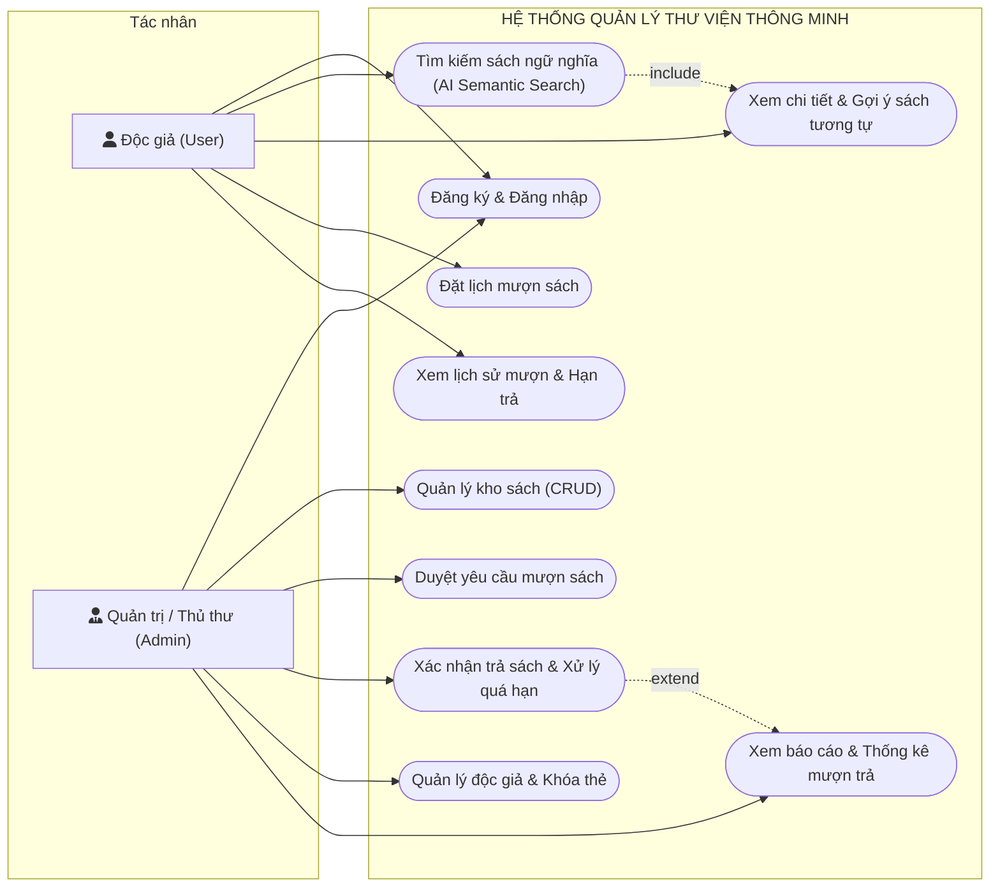
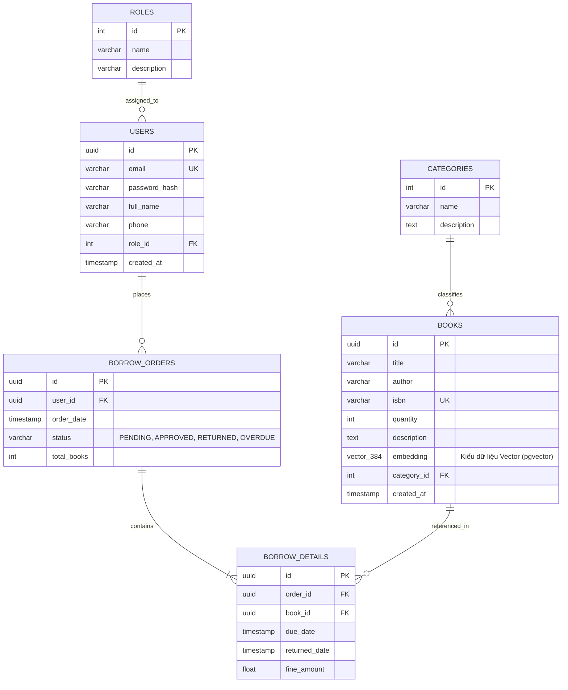
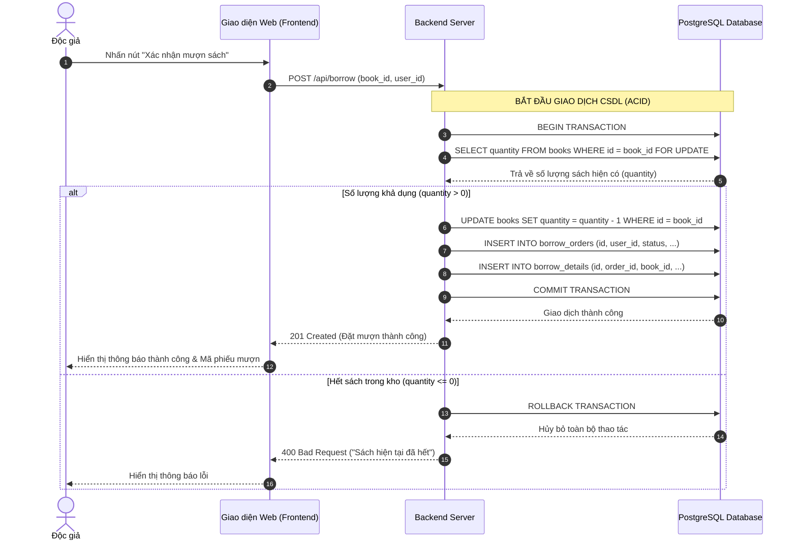

# MÃ NGUỒN MERMAID & PROMPT CHATFLOWCHART CHO 3 SƠ ĐỒ ĐẦU TIÊN
**Học phần:** Chuyên đề 1: Khai thác hệ cơ sở dữ liệu  
**Đề tài:** Hệ thống Quản lý Thư viện Thông minh (Vector DB / Pgvector & Tối ưu hóa Truy vấn)

---

## 📖 HƯỚNG DẪN SỬ DỤNG NHANH

### Cách 1: Sử dụng trong Draw.io (Khuyên dùng - Miễn phí 100%)
1. Truy cập [draw.io (app.diagrams.net)](https://app.diagrams.net/).
2. Trên thanh menu, chọn: **Arrange** (Sắp xếp) ➔ **Insert** (Chèn) ➔ **Advanced** (Nâng cao) ➔ **Mermaid**.  
   *(Hoặc bấm vào biểu tượng dấu cộng `+` trên thanh công cụ ➔ Advanced ➔ Mermaid)*.
3. Sao chép toàn bộ khối mã trong phần **MÃ MERMAID CHO DRAW.IO** dán vào khung.
4. Bấm **Insert** ➔ Sơ đồ sẽ tự động vẽ ra canvas, bạn có thể tự do kéo thả, chỉnh font chữ, màu sắc và xuất ảnh sắc nét.

### Cách 2: Sử dụng trong ChatFlowchart.com
1. Truy cập [chatflowchart.com](https://chatflowchart.com/).
2. Sao chép đoạn văn bản trong phần **PROMPT DÁN VÀO CHATFLOWCHART** dán vào ô chat.
3. Nhấn gửi để AI tự động vẽ sơ đồ.

---

## 1. SƠ ĐỒ USE CASE TỔNG QUÁT (OVERALL USE CASE DIAGRAM)

### A. Mã Mermaid cho Draw.io


### B. Prompt dán vào ChatFlowchart.com
```text
Hãy vẽ sơ đồ Use Case (Use Case Diagram) chuẩn UML cho "Hệ thống Quản lý Thư viện Thông minh":
1. Tác nhân Độc giả (Reader):
   - Đăng ký và Đăng nhập tài khoản
   - Tìm kiếm sách theo ngữ nghĩa (AI Semantic Search)
   - Xem chi tiết sách và Gợi ý sách tương đồng
   - Đặt lịch mượn sách
   - Theo dõi lịch sử mượn, hạn trả sách
2. Tác nhân Thủ thư / Quản trị viên (Admin/Librarian):
   - Đăng nhập hệ thống
   - Quản lý danh mục & Kho sách (Thêm, Sửa, Xóa)
   - Duyệt yêu cầu mượn sách
   - Xác nhận trả sách và Tính phí phạt quá hạn
   - Quản lý tài khoản độc giả
   - Xem báo cáo và Thống kê sách mượn nhiều nhất
Vẽ ranh giới hệ thống rõ ràng, các oval use case liên kết chuẩn với từng actor.
```

---

## 2. SƠ ĐỒ THỰC THỂ QUAN HỆ VẬT LÝ (PHYSICAL ERD / DATABASE SCHEMA)

### A. Mã Mermaid cho Draw.io


### B. Prompt dán vào ChatFlowchart.com
```text
Hãy vẽ sơ đồ Thực thể Quan hệ Vật lý (Physical ERD Diagram) chi tiết cho CSDL PostgreSQL của Hệ thống Quản lý Thư viện:
1. Bảng ROLES: id (PK, int), name (varchar), description (varchar).
2. Bảng USERS: id (PK, uuid), email (UK, varchar), password_hash (varchar), full_name (varchar), phone (varchar), role_id (FK trỏ về ROLES), created_at (timestamp).
3. Bảng CATEGORIES: id (PK, int), name (varchar), description (text).
4. Bảng BOOKS: id (PK, uuid), title (varchar), author (varchar), isbn (UK, varchar), quantity (int), description (text), embedding (vector(384) dùng cho pgvector AI), category_id (FK trỏ về CATEGORIES), created_at (timestamp).
5. Bảng BORROW_ORDERS: id (PK, uuid), user_id (FK trỏ về USERS), order_date (timestamp), status (varchar), total_books (int).
6. Bảng BORROW_DETAILS: id (PK, uuid), order_id (FK trỏ về BORROW_ORDERS), book_id (FK trỏ về BOOKS), due_date (timestamp), returned_date (timestamp), fine_amount (float).
Thể hiện rõ các mối quan hệ 1-N (One-to-Many), khóa chính PK, khóa ngoại FK và kiểu dữ liệu từng cột.
```

---

## 3. SƠ ĐỒ TUẦN TỰ GIAO DỊCH MƯỢN SÁCH (SEQUENCE DIAGRAM - ACID TRANSACTION)

### A. Mã Mermaid cho Draw.io


### B. Prompt dán vào ChatFlowchart.com
```text
Hãy vẽ Sơ đồ Tuần tự (Sequence Diagram) chuẩn UML thể hiện Nghiệp vụ Mượn Sách có Xử lý Giao dịch ACID (Database Transaction):
Gồm 4 đối tượng:
1. Độc giả (Reader)
2. Giao diện Web (Frontend)
3. Backend API (Server)
4. PostgreSQL (Database)

Luồng xử lý chi tiết:
- Độc giả bấm "Xác nhận mượn sách" trên Giao diện Web.
- Web gửi request POST /api/borrow đến Backend API.
- Backend gửi lệnh "BEGIN TRANSACTION" đến PostgreSQL.
- Backend truy vấn khóa dòng "SELECT quantity FROM books FOR UPDATE".
- Database trả về giá trị quantity.
- Nhánh Alt điều kiện:
  + Nếu quantity > 0: Backend thực hiện "UPDATE books SET quantity = quantity - 1", sau đó "INSERT INTO borrow_orders", sau đó gửi lệnh "COMMIT TRANSACTION". Database xác nhận thành công, Backend trả về 201 Created cho Web, Web báo thành công cho Độc giả.
  + Nếu quantity <= 0: Backend gửi lệnh "ROLLBACK TRANSACTION". Database hủy giao dịch, Backend trả về 400 Bad Request (Hết sách), Web báo lỗi cho Độc giả.
```

