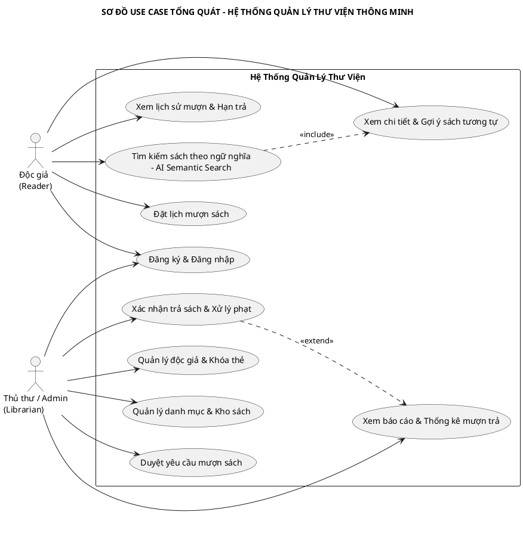
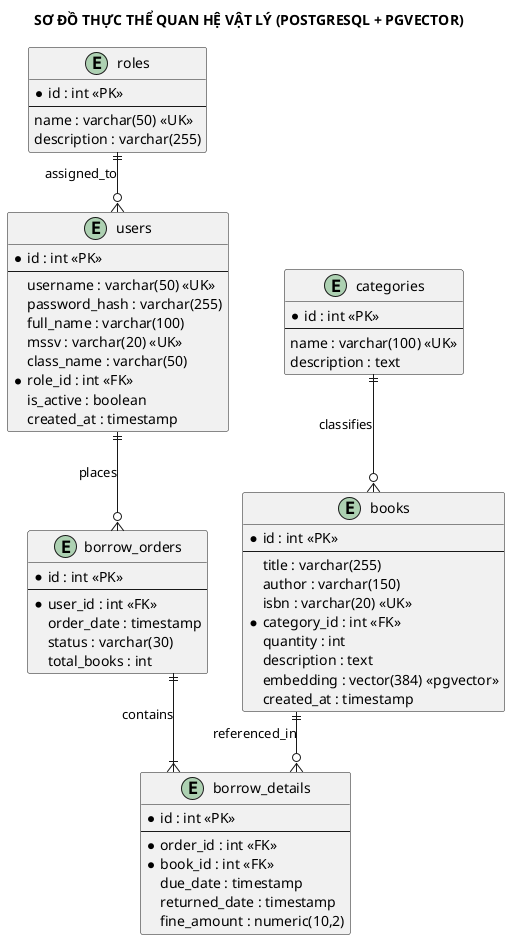
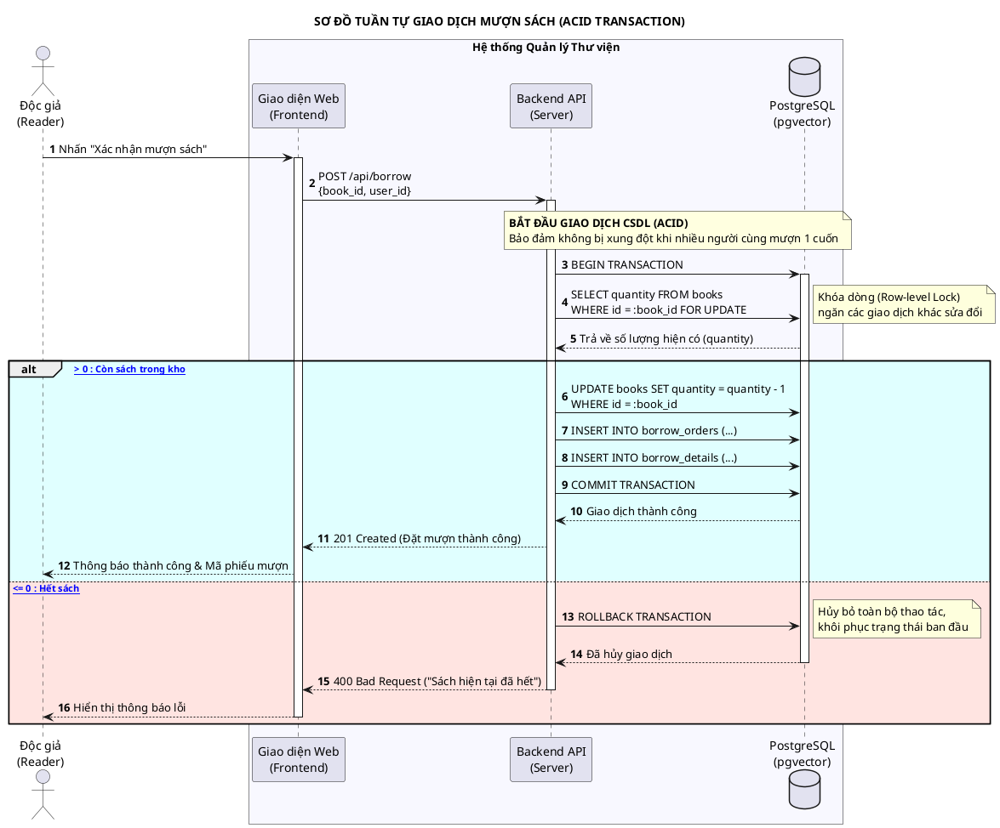
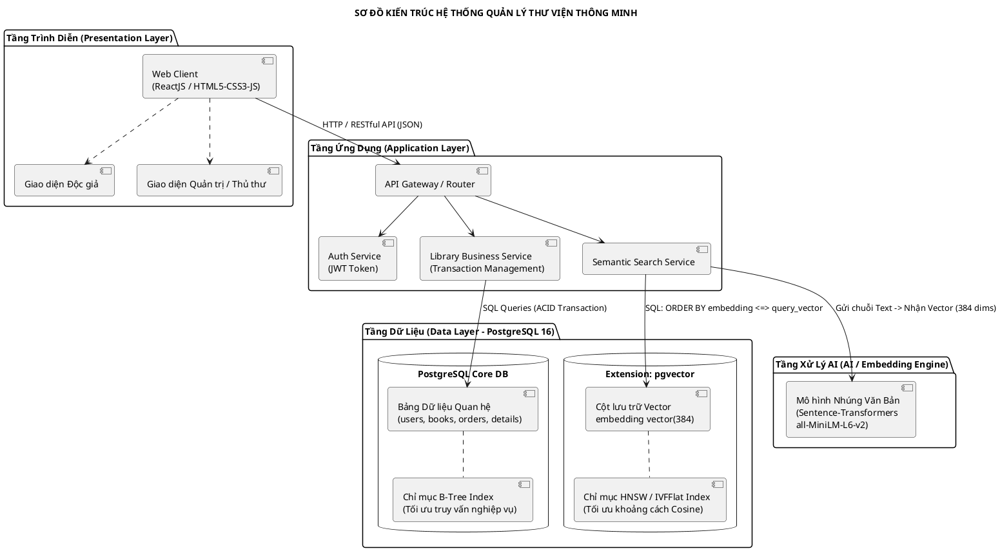
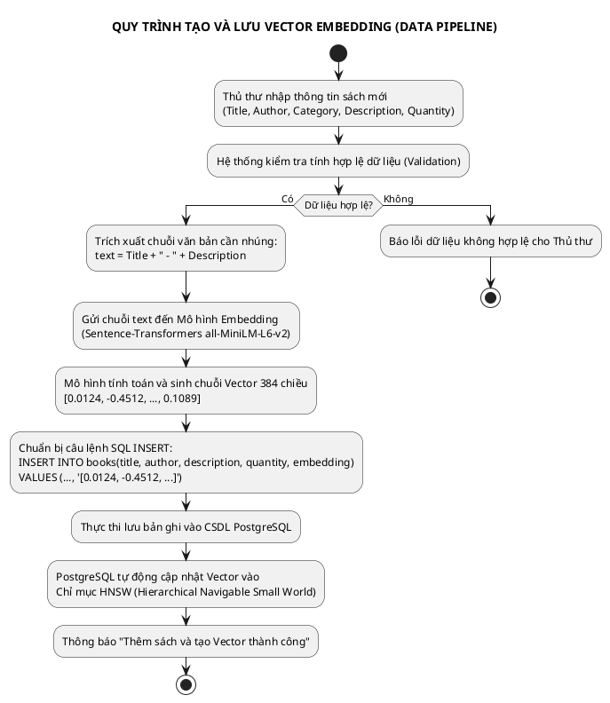
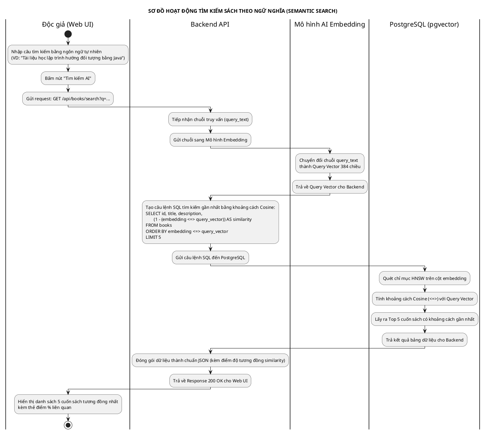
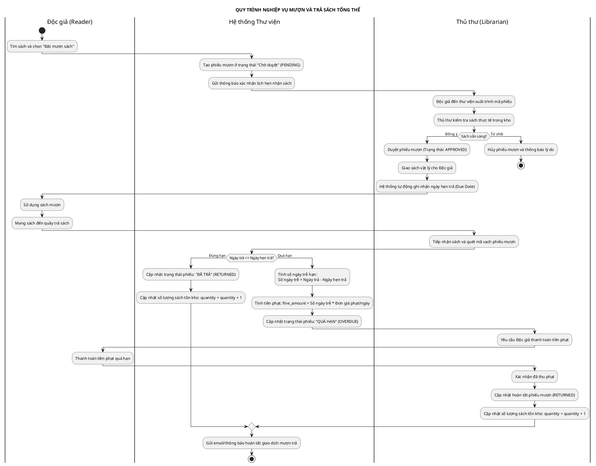
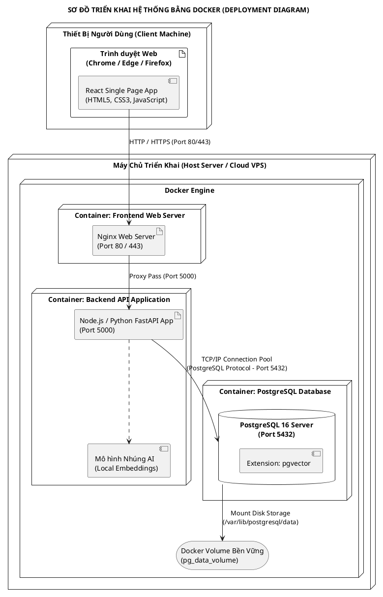

# MÃ NGUỒN PLANTUML CHO TOÀN BỘ 8 SƠ ĐỒ
**Học phần:** Chuyên đề 1: Khai thác hệ cơ sở dữ liệu  
**Đề tài:** Hệ thống Quản lý Thư viện Thông minh (Vector DB / Pgvector & Tối ưu hóa Truy vấn)

---

## 📌 HƯỚNG DẪN SỬ DỤNG
1. Mở trang web: [plantuml.com/plantuml](https://www.plantuml.com/plantuml)
2. Sao chép từng đoạn mã bên dưới dán vào khung vẽ.
3. Bấm Submit để xem sơ đồ và tải ảnh PNG/SVG về dán vào báo cáo.

---

### 1. SƠ ĐỒ USE CASE TỔNG QUÁT (USE CASE DIAGRAM)

---

### 2. SƠ ĐỒ THỰC THỂ QUAN HỆ VẬT LÝ (PHYSICAL ERD)

---

### 3. SƠ ĐỒ TUẦN TỰ GIAO DỊCH MƯỢN SÁCH ACID (SEQUENCE DIAGRAM)

---

### 4. SƠ ĐỒ KIẾN TRÚC HỆ THỐNG (SYSTEM ARCHITECTURE DIAGRAM)

---

### 5. SƠ ĐỒ LUỒNG DỮ LIỆU TẠO VECTOR (VECTOR DATA PIPELINE)

---

### 6. SƠ ĐỒ HOẠT ĐỘNG TÌM KIẾM NGỮ NGHĨA (SEMANTIC SEARCH)

---

### 7. SƠ ĐỒ HOẠT ĐỘNG LUỒNG MƯỢN / TRẢ SÁCH (ACTIVITY DIAGRAM)

---

### 8. SƠ ĐỒ TRIỂN KHAI HỆ THỐNG (DEPLOYMENT DIAGRAM)

